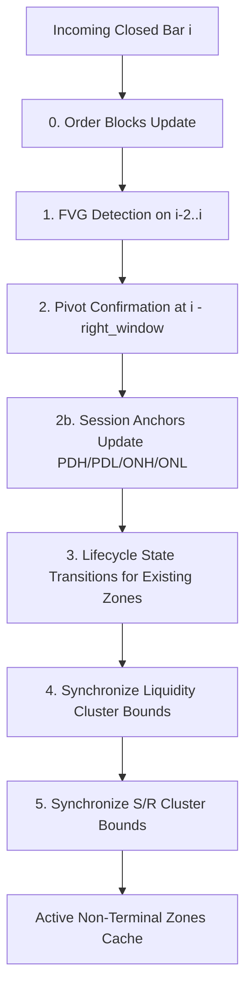

# FARS Zone Engine — Technical Architecture & Specification

**Document:** `FARS_A_KAI_01_ZONE_ENGINE.md`  
**Audience:** Technical delivery for Kai (Architecture & Quant Engineering)  
**Status:** Canonical & Audited  
**Repository Source:** `E:\FARS-LAB\FARS\src\zones\`  

---

## 1. Executive Summary & Design Principles

The FARS Zone Engine (`src/zones/`) provides an incremental, point-in-time market geometry framework designed for systematic futures trading (NQ, MNQ, ES, CL, GC). It detects, tracks, and evaluates structural market features—Fair Value Gaps (FVG), Liquidity Pools (EQH/EQL), Support/Resistance zones with physical thickness, Session Levels (PDH/PDL/D20/ONH/ONL), and Order Blocks (OB)—without lookahead bias.

The architecture adheres to five strict quantitative principles:

1. **Strict Temporal Causality & No Lookahead**: Every zone possesses two distinct timestamps: `pattern_time` (the timestamp of the candle or pattern origin) and `available_at` (the timestamp of the candle close at which the pattern is mathematically confirmed and usable). For any valid zone, the hard invariant `available_at >= pattern_time` is strictly enforced.
2. **Append-Only Incremental Streaming**: The orchestrator (`ZoneEngine`) consumes one closed bar at a time. It rejects historical mutations or rewrites. By construction, real-time live replay and batch backtesting produce identical zones bit-for-bit.
3. **Deterministic Hashing**: Every zone is assigned a deterministic 16-character hexadecimal identifier derived from a canonical SHA-256 hash of its immutable definition parameters (type, symbol, timeframe, direction, pattern timestamp, and an invariant anchor). Dynamic updates to zone bounds or touch counts never alter this identifier.
4. **Physical Thickness & Geometry**: Horizontal zones are never treated as infinitesimal single-price lines. Zones maintain explicit `[lower, upper]` bounds and a `midpoint`. Support and Resistance zones span the true candle body/wick ranges of the supporting pivots.
5. **Separation of Raw Geometry from Scoring**: The engine exposes raw geometric features, spatial distances, penetration depths, and lifecycle states directly to execution strategies. It deliberately avoids heuristic "black-box" magic scores.

---

## 2. Source Code Architecture & File Map

The entire module is contained within `src/zones/` and organized by single-responsibility components:

| File Path | Primary Responsibility | Key Classes / Functions |
|:---|:---|:---|
| [`src/zones/models.py`](file:///E:/FARS-LAB/FARS/src/zones/models.py) | Domain types, dataclasses, invariants, and deterministic ID hashing. | `Zone`, `ZoneType`, `ZoneState`, `make_zone_id` |
| [`src/zones/fvg.py`](file:///E:/FARS-LAB/FARS/src/zones/fvg.py) | 3-bar Fair Value Gap detection and lifecycle state machine. | `fvg_zones_from_bars`, `transition_fvg`, `detect_fvg` |
| [`src/zones/liquidity.py`](file:///E:/FARS-LAB/FARS/src/zones/liquidity.py) | Confirmed swing pivot clustering, EQH/EQL pools, and sweep detection. | `LiquidityClusterer`, `ConfirmedPivot`, `transition_liquidity` |
| [`src/zones/session_levels.py`](file:///E:/FARS-LAB/FARS/src/zones/session_levels.py) | Macro session anchors (PDH, PDL, D20 High/Low, Overnight High/Low). | `SessionLevelsBuilder`, `SessionLevelZone` |
| [`src/zones/levels.py`](file:///E:/FARS-LAB/FARS/src/zones/levels.py) | Support/Resistance band clustering with physical width and touch memory. | `SupportResistanceClusterer`, `SrPivot`, `transition_sr` |
| [`src/zones/order_blocks.py`](file:///E:/FARS-LAB/FARS/src/zones/order_blocks.py) | Streaming Order Block detection (impulse expansion + MSS). | `OrderBlockBuilder` |
| [`src/zones/engine.py`](file:///E:/FARS-LAB/FARS/src/zones/engine.py) | Central incremental orchestrator, bar ingestion, and context query API. | `ZoneEngine` |

---

## 3. Domain Model & Hard Invariants (`src/zones/models.py`)

### 3.1 Type Definitions

The domain is formalized using Python string literals for zero-overhead JSON serialization:

```python
ZoneType = Literal[
    "fvg", "liquidity", "support", "resistance", "order_block",
    "volume_void", "session_level",
]
ZoneState = Literal["active", "touched", "partial", "swept", "mitigated", "broken", "expired"]
ZoneDirection = Literal["long", "short", "neutral"]

TERMINAL_STATES: frozenset[str] = frozenset({"mitigated", "broken", "expired"})
```

### 3.2 Deterministic Identification (`make_zone_id`)

Zone IDs must remain deterministic across separate processes, threads, and replays. The identifier is calculated as:

```python
def make_zone_id(
    zone_type: str,
    symbol: str,
    timeframe: str,
    direction: str,
    pattern_time: datetime,
    anchor: tuple,
) -> str:
    raw = json.dumps(
        [zone_type, symbol, timeframe, direction, pattern_time.isoformat(), list(anchor)],
        sort_keys=True, separators=(",", ":"),
    ).encode("utf-8")
    return hashlib.sha256(raw).hexdigest()[:16]
```

> **Invariant Rule for Anchors**: The `anchor` tuple is chosen by the emitter and **must be invariant** to future zone lifecycle growth. For an FVG, the anchor is its originating bar indices. For liquidity pools, it is the originating pivot index. Never pass mutable price bounds or touch counts into the anchor.

### 3.3 The `Zone` Dataclass & Enforcement

The `Zone` entity is an immutable (frozen) dataclass:

```python
@dataclass(frozen=True)
class Zone:
    zone_id: str
    zone_type: ZoneType
    symbol: str
    timeframe: str

    lower: float
    upper: float
    midpoint: float

    direction: ZoneDirection

    pattern_time: datetime
    available_at: datetime

    state: ZoneState = "active"
    touches: int = 0
    strength: float = 0.0

    source_bar_ids: tuple[int, ...] = ()
    metadata: dict[str, Any] = field(default_factory=dict)
```

The `__post_init__` hook validates three critical invariants on instantiation:
1. **Geometric Consistency**: `self.lower <= self.midpoint <= self.upper` (raises `ValueError` otherwise).
2. **Temporal Causality**: `self.available_at >= self.pattern_time` (raises `ValueError` otherwise).
3. **Valid Price Space**: `self.lower > 0 and self.upper > 0`.

---

## 4. Sub-Engine Components

### 4.1 Fair Value Gap Engine (`src/zones/fvg.py`)

#### Formation Mechanics
An FVG requires a 3-bar sequence ($t-2, t-1, t$). The gap occurs across the middle bar ($t-1$) and is confirmed strictly upon the close of bar $t$:
- **Bullish FVG (`direction="long"`)**: Formed when `low[t] > high[t-2]`.
  - `lower = high[t-2]`
  - `upper = low[t]`
  - `midpoint = (lower + upper) / 2.0`
- **Bearish FVG (`direction="short"`)**: Formed when `high[t] < low[t-2]`.
  - `lower = high[t]`
  - `upper = low[t-2]`
  - `midpoint = (lower + upper) / 2.0`
- **Minimum Gap Filter**: `(upper - lower) / lower >= min_gap_pct`.

#### Lifecycle Transitions (`transition_fvg`)
At each subsequent closed bar, the zone state progresses monotonically:
- `active`: Price has not penetrated the zone bounds.
- `touched`: Price penetrated between `lower` and `upper` by $\ge 1$ tick, but did not breach the mitigation threshold.
- `partial`: Price penetrated past the `midpoint` (Consequent Encroachment / CE).
- `mitigated`: Price fulfilled the configured `mitigation` rule (`"wick_touch"`, `"midpoint"`, `"full_fill"`, or `"close_through"`).
- `expired`: Zone age exceeded `max_age_bars`.

Once a zone enters a terminal state (`is_terminal() == True`), it is permanently retired from active queries.

---

### 4.2 Liquidity Engine & EQH/EQL (`src/zones/liquidity.py`)

#### Pivot Confirmation & Lookback Lag
Pivots are identified using canonical swing detection (`find_swings`) with symmetric windows (`pivot_left`, `pivot_right`, default 3/3).
- A swing at bar index $j = i - \text{pivot\_right}$ is **only confirmed at bar $i$**.
- Therefore, `available_at = bar[i].timestamp`. No information from bar $j$ is emitted prior to bar $i$.

#### Dynamic 1D Clustering (`LiquidityClusterer`)
Pivots on the same side (highs or lows) are aggregated into pools using dynamic tolerance $\epsilon$:
$$\epsilon = \max\left(\text{tick\_tolerance} \times \text{tick\_size},\ \text{atr\_tolerance} \times \text{ATR}\right)$$
For NQ/MNQ (tick = 0.25): with 4 ticks and 10% of a 15-point ATR, $\epsilon = \max(1.0, 1.5) = 1.50$ points.

#### Pool Categories & Requirements
- `eqh` (Equal Highs): Clustered swing highs where $|piv_a - piv_b| \le \epsilon$. Requires $\ge \text{min\_touches}$ (default 2).
- `eql` (Equal Lows): Clustered swing lows within $\epsilon$.
- `buyside` / `sellside`: Structural liquidity pools resting above high clusters or below low clusters.
- **Sweep Event**: Triggered when a subsequent bar trades through the extreme boundary (`high > upper` for highs or `low < lower` for lows) and closes back across, marking the pool as `state="swept"`.

---

### 4.3 Support & Resistance with Physical Thickness (`src/zones/levels.py`)

Unlike classic charting lines, `SupportResistanceClusterer` preserves the physical range of the candles contributing to the cluster:
- **`SrPivot` Input**: Stores `(bar_idx, level, bar_low, bar_high, side, confirmed_bar_idx, pattern_time, available_at)`.
- **Zone Span**: When pivots cluster within tolerance, the resulting zone bounds are set to:
  - `lower = min(p.bar_low for p in cluster_pivots)` (or bottom quantile of reaction range)
  - `upper = max(p.bar_high for p in cluster_pivots)`
  - `midpoint = mean(p.level for p in cluster_pivots)`
- **Strength**: Dynamic score computed from the count of independent pivot bounces and touch recency.

---

### 4.4 Session Anchors & Macro Levels (`src/zones/session_levels.py`)

The `SessionLevelsBuilder` captures institutional session reference points, parameterized by market hours (RTH: 09:30–16:00 ET; Globex: 18:00–09:30 ET):

1. **`PREV_DAY_HIGH` (PDH) & `PREV_DAY_LOW` (PDL)**:
   - High and Low of the preceding completed RTH session.
   - Available immediately at the close of that session (16:00 ET) or start of Globex.
2. **`D20_HIGH` & `D20_LOW`**:
   - Rolling 20-session high and low computed across the preceding 20 completed RTH sessions.
3. **`OVERNIGHT_HIGH` (ONH) & `OVERNIGHT_LOW` (ONL)**:
   - Extrema of the Globex session spanning 18:00 to 09:30 ET.
   - **Frozen at 09:30 ET**: At the exact opening of RTH, the overnight extremes are locked and emitted as immutable session anchor zones for the RTH trading day.

---

### 4.5 Streaming Order Blocks (`src/zones/order_blocks.py`)

The `OrderBlockBuilder` operates causally on the bar stream with exact parity to SMC-OB:
1. **Displacement Detection**: Scans for an aggressive expansion candle with range $\ge 2.0 \times \text{ATR}$.
2. **Market Structure Shift (MSS)**: Verifies that the impulse breaks a recent confirmed swing pivot.
3. **Anchor Selection**: Identifies the last opposing-color candle prior to the displacement:
   - Bullish OB: The last bearish candle before the upward displacement. Zone bounds are defined by that candle's high and low (or body).
   - Bearish OB: The last bullish candle before the downward displacement.
4. **Availability**: `available_at` is set to the close of the displacement bar confirming the MSS.

---

## 5. The Incremental Orchestrator (`src/zones/engine.py: ZoneEngine`)

### 5.1 Initialization & Configuration

```python
engine = ZoneEngine(
    symbol="MNQ",
    timeframe="5m",
    tick_size=0.25,
    pivot_left=3,
    pivot_right=3,
    min_gap_pct=0.001,
    fvg_mitigation="wick_touch",
    liquidity_min_touches=2,
    liquidity_tick_tol=4,
    liquidity_atr_tol=0.10,
    session_pools=True,
    d20_sessions=20,
)
```

### 5.2 The Ingestion Pipeline (`update`)

The method `engine.update(history: Sequence[Any])` enforces an append-only invariant:
- Checks `len(history) >= self._seen`.
- Validates the signature `(timestamp, open, high, low, close)` of the last processed bar against incoming history. If past history was rewritten, it raises an immediate `ValueError`.

For each newly arrived closed bar $i$, `engine._on_bar(history, i)` executes seven sequential stages:



1. **Order Blocks**: Emits newly formed order blocks whose displacement closed at bar $i$.
2. **FVGs**: Emits 3-bar gaps formed across bars $[i-2, i-1, i]$.
3. **Pivots & Clusters**: If bar $i$ confirms a swing at $j = i - \text{pivot\_right}$, feeds `ConfirmedPivot` and `SrPivot` into liquidity and S/R clusterers.
4. **Session Anchors**: Evaluates session transitions (Globex $\to$ RTH) and freezes/retires session levels.
5. **Lifecycle Progression**: Updates states of all zones with `available_bar_index < i`. (Zones born at bar $i$ are protected from same-bar mitigation artifacts).
6. **Geometry Sync**: Updates boundaries of active liquidity and S/R clusters as new touches expand cluster depth, preserving zone identity.

---

## 6. Query Interface & Feature Context

### 6.1 Spatial & State Queries

```python
# Returns all active non-terminal zones, sorted chronologically
zones: tuple[Zone, ...] = engine.active_zones(zone_type="fvg", direction="long")

# Returns the N closest active zones to the current price
near_zones: tuple[Zone, ...] = engine.nearest_zones(price=20450.25, limit=5)
```

### 6.2 Raw Feature Extraction (`engine.context(price, atr)`)

Execution strategies query `engine.context(price, atr)` to retrieve point-in-time contextual features without maintaining internal zone trackers:

```python
ctx = engine.context(price=current_close, atr=current_atr)
```

Exposed dictionary keys include:
- `inside_bull_fvg` / `inside_bear_fvg` (`bool`): Price is within active FVG bounds.
- `fvg_age` (`int`): Bars elapsed since the nearest FVG was confirmed.
- `fvg_fill` (`float` in $[0.0, 1.0]$): Penetration ratio of the nearest FVG.
- `dbuy` / `dsell` (`float`): Point distance to nearest buyside / sellside liquidity pool.
- `touched` / `swept` (`bool`): Interaction state of nearest liquidity pool.
- `inside_sr_zone` (`bool`) & `support_strength` (`float`): Presence and weight of overlapping S/R.
- `fvg_liq_overlap` (`bool`): Structural confluence flag (an active FVG geometrically coincides with a liquidity pool).
- 16 session metrics (`d_pdh_pts`, `d_pdl_pts`, `d_onh_pts`, `d_onl_pts`, and their ATR-normalized equivalents).

---

## 7. Replay vs. Backtest Parity Verification

To ensure production stability, `tests/test_zones_parity.py` asserts bit-for-bit equivalence between:
1. **Batch Mode**: Running `ZoneEngine` over 500,000 continuous M5 bars.
2. **Streaming Mode**: Streaming the same bars one-by-one through a websocket-mocked feeder.

Every active `zone_id`, `state`, `touches`, and price boundary matches exactly across runs, guaranteeing that live execution encounters the identical mathematical environment evaluated in research.
