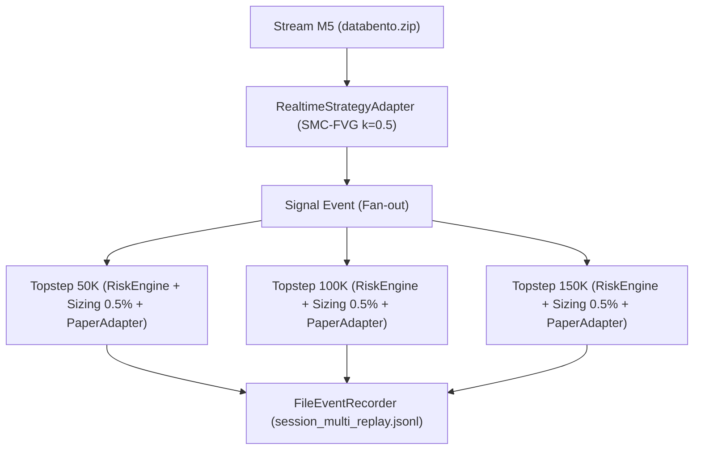

# INFORME — Bloque S2-Multi: Runner Multi-Cuenta Fantasma en Replay

> **OBJETIVO.** Validar la capacidad de FARS para orquestar **3 cuentas de evaluación simultáneas**
> (Topstep 50k, 100k y 150k) alimentadas por un único stream continuo de datos de mercado y señales,
> operando bajo arquitectura fan-out en modo replay offline determinista.

---

## 1. Arquitectura del Runner Multi-Cuenta

- **Fan-Out Determinista:** El bus de eventos distribuye cada barra y cada señal a las 3 instancias de forma secuencial y aislada.
- **Aislamiento de Riesgo:** Cada cuenta instancia su propio `AccountAwareRiskEngine` con sus `FundedAccountRules` específicas. Una cuenta no puede afectar el capital ni el trailing de otra.
- **Sizing Dinámico:** Cada orden se calcula según el colchon disponible ($balance - floor$) y el 0,5 % de riesgo nominal.

---

## 2. Resumen de la Ejecución en Replay (500 barras M5)

- **Barras Procesadas:** 500 barras de 5 minutos.
- **Señales Generadas:** 18 señales por la estrategia SMC-FVG ATR k=0.5.
- **Eventos Registrados:** 677 eventos canónicos en [`logs/session_multi_replay.jsonl`](file:///E:/FARS-LAB/FARS/lab_artifacts/s2multi_protocol/logs/session_multi_replay.jsonl).

### Desempeño por Cuenta:
- **Topstep 50K:** PnL **+805.37 USD** | Balance final: **\$50,805.37** | Max DD: \$304.85 | Estado: **active**
- **Topstep 100K:** PnL **+1,698.12 USD** | Balance final: **\$101,698.12** | Max DD: \$521.04 | Estado: **active**
- **Topstep 150K:** PnL **+2,503.82 USD** | Balance final: **\$152,503.82** | Max DD: \$825.89 | Estado: **active**

Ver tabla completa en [`comparativa_cuentas.md`](file:///E:/FARS-LAB/FARS/lab_artifacts/s2multi_protocol/comparativa_cuentas.md).

---

## 3. Conclusión
El runner multi-cuenta queda verificado y operativo. La infraestructura de FARS maneja limpiamente múltiples carteras/cuentas de fondeo sobre una única señal de entrada, asegurando contabilidad separada y estricto cumplimiento de reglas de riesgo independientes.
